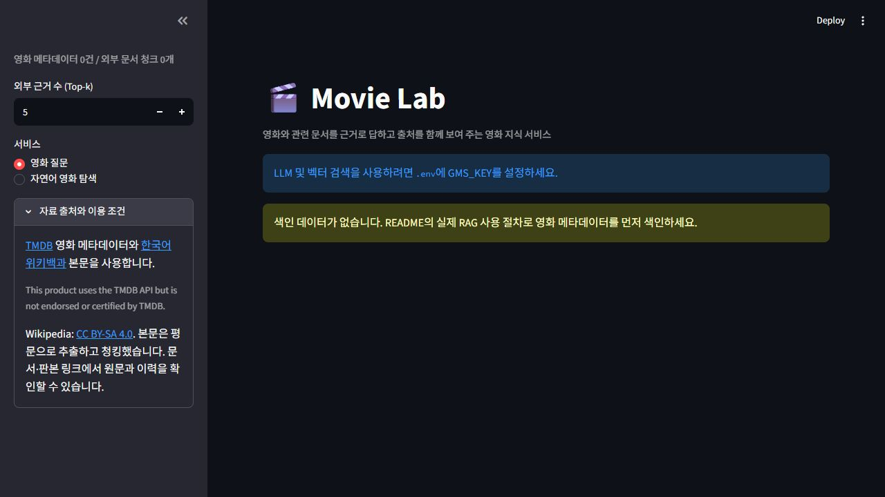

# Movie Lab — 영화 Wikipedia RAG

영화 메타데이터 964편과 한국어 위키백과를 근거로 답하는 Streamlit 앱입니다. 기존 영화 Q&A, 과학·역사 사실 검증, 자연어 조건 탐색, 영화별 대화 분리를 유지합니다.

기본 흐름은 **P1 검색어 생성 → 공식 MediaWiki 검색 → P2 문서 채택·탈락 → 채택한 문서 본문 수집 → 청킹·색인 → 검색 → 근거 답변**입니다. LangGraph의 실행 노드는 원본과 같이 `retrieve`, `generate` 두 개입니다. 수집·선별·색인은 `retrieve` 안에서 수행합니다.

## 작업 위치와 원본

- 저장소: <https://github.com/ahra1221/AICoreProject>
- 작업 경로: `C:\Dev\AICoreProject`
- 기준 커밋: `51518f675c99c6cf5f4d817874f1658ff91c47ba`
- 저장소의 `src/graph.py`, `src/prompts.py`, `src/collector.py` 등 베이스 구조를 재사용했습니다. 별도의 최초 수업 노트북/베이스 원본은 저장소에서 찾지 못했습니다. 그 코드와의 완전한 동일성은 확인하지 못했으며, 첨부된 27개 체크리스트와 전달된 요구사항 요약을 기준으로 보완했습니다.
- 기존 `data/`, `chroma_db/`는 보존합니다. 새 기본 색인 경로는 `chroma_db_wikipedia/`입니다. 다른 프로젝트의 키·환경·서버는 사용하지 않습니다.

## 설치

Python 3.11을 권장합니다. `requirements.txt`의 버전을 사용합니다.

```powershell
Set-Location C:\Dev\AICoreProject
python -m venv .venv
.\.venv\Scripts\python.exe -m pip install -r requirements.txt
Copy-Item .env.example .env
```

이미 `.venv`나 `.env`가 있으면 다시 만들거나 덮어쓰지 말고 확인하세요. 이번 작업에서 프로젝트 전용 `.venv`를 설치했으며 `.env`와 인증키는 만들지 않았습니다.

`.env.example`에는 설정 이름과 빈 값만 들어 있습니다. 실제 값은 이 프로젝트의 `.env`에 직접 넣습니다.

| 설정 | 의미 / 코드 기본값 |
|---|---|
| `GMS_KEY` | 이 프로젝트에서 별도로 승인받은 키. 기본값 없음 |
| `MOVIELAB_GMS_KEY` | 이 프로젝트 전용 프로세스 환경변수 대안. 기본값 없음 |
| `GMS_BASE_URL` | 기존 GMS endpoint, `https://gms.ssafy.io/gmsapi/api.openai.com/v1/` |
| `GMS_MODEL` / `GMS_EMBEDDING_MODEL` | 기존 기본값 `gpt-5.4-nano` / `text-embedding-3-small`; 실제 계정 지원 여부는 미확인 |
| `WIKI_CONTACT` | 연락 가능한 이메일 또는 프로젝트 URL. API 모드에 필요 |
| `WIKI_MODE` | `api` 기본값. 제한된 네트워크에서는 명시적으로 `snapshot` 선택 |
| `WIKI_REQUEST_INTERVAL` | 최소 요청 간격, 기본 1초, 허용 1~60초 |
| `WIKI_CACHE_TTL` | API·질문 캐시 유효기간, 기본 86400초, 허용 60~604800초 |
| `WIKI_MAX_QUERIES` / `WIKI_MAX_DOCUMENTS` | 질문당 검색어 4개 / 채택 본문 5개 상한 |
| `CHUNK_SIZE` / `CHUNK_OVERLAP` | 1000 / 200. 외부 본문에만 적용 |
| `TOP_K` / `MIN_RELEVANCE` | 외부 근거 5개 / 거리 점수 하한 0.15. 메타데이터 근거 1건은 별도 |
| `MOVIES_PATH` / `WIKI_DIR` / `CHROMA_DIR` | 원본 데이터 경로 / 원본 스냅샷 경로 / 새 색인 경로 |

다른 작업에서 설정한 일반 프로세스 변수 `GMS_KEY`는 자동으로 가져오지 않습니다. `.env`의 `GMS_KEY` 또는 이 프로젝트 전용 `MOVIELAB_GMS_KEY`만 사용합니다. 모델명 기본값은 사용 가능성을 보증하지 않습니다.

## 무료 검증과 실행

```powershell
# 외부 소켓을 차단한 단위·로컬 Chroma·Streamlit 자동 테스트
.\.venv\Scripts\python.exe scripts/test_offline.py

# 모의 모델/테스트 벡터로 두 노드, 재질문 캐시, Top-k 비교 기록
.\.venv\Scripts\python.exe scripts/verify_offline_flow.py

# 유료 호출 없이 영화 메타데이터 색인 규모 확인
.\.venv\Scripts\python.exe scripts/build_index.py --metadata-only --estimate-only

# 무료 공개 API 검색·본문·판본·반복 캐시만 검증; P1/P2 LLM 호출 없음
.\.venv\Scripts\python.exe scripts/verify_wikipedia.py --movie-id 157336 --contact https://github.com/ahra1221/AICoreProject

# 먼저 사용 여부를 확인하고 비어 있는 별도 포트로 실행
Get-NetTCPConnection -LocalPort 8521 -State Listen -ErrorAction SilentlyContinue
.\.venv\Scripts\python.exe -m streamlit run app.py --server.address 127.0.0.1 --server.port 8521
```

포트 8521이 이미 쓰이고 있으면 그 프로세스를 중지하지 말고 다른 비어 있는 포트를 선택합니다. 기존 다른 프로젝트의 8510 포트는 사용하지 않습니다. 키나 색인이 없을 때도 앱은 안내 화면을 표시합니다.

## 실제 RAG 사용 (별도 키·호출 예산 필요)

이번 작업에서는 유료 LLM/임베딩 API를 호출하지 않았습니다. 아래 명령은 키와 예산을 별도로 준비한 뒤 실행할 수 있는 방법입니다.

```powershell
# API 수집 경로: 메타데이터 964건을 먼저 색인하고 외부 본문은 질문별로 수집
.\.venv\Scripts\python.exe scripts/build_index.py --metadata-only --allow-paid-api

# 소규모 확인: 메타데이터 10편만 색인
.\.venv\Scripts\python.exe scripts/build_index.py --metadata-only --test-mode --test-movies 10 --allow-paid-api
```

`--allow-paid-api`가 없으면 색인 명령은 임베딩 호출 전에 종료합니다. 최초 연결 사전 검사도 임베딩 입력 1건입니다. 앱의 질문 제출·조건 탐색은 설정된 모델/임베딩 호출을 발생시킵니다. API 모드에서는 기존 문서가 있더라도 새 질문에 P1→검색→P2를 수행하고, 같은 영화·질문·모델·수집/청킹 설정은 캐시를 재사용합니다. Top-k만 바꾸면 수집 캐시를 재사용하면서 근거 수를 비교할 수 있습니다.

네트워크 제한 환경에서는 `.env`의 `WIKI_MODE`를 `snapshot`으로 바꾸면 기존 3,725개 문서 묶음에서 P2 선별 후 색인합니다. 예전 방식의 일괄 스냅샷 색인도 남아 있습니다.

```powershell
.\.venv\Scripts\python.exe scripts/build_index.py --test-mode --test-movies 10 --allow-paid-api
.\.venv\Scripts\python.exe scripts/build_index.py --allow-paid-api
```

전체 스냅샷 갱신은 API로 추가한 다른 문서를 삭제하지 않습니다. 갱신한 영화·문서의 오래된 꼬리 청크만 새 청크 저장 성공 후 제거합니다.

## 확인된 결과와 한계

- `docs/evidence/offline-tests.json`: 소켓 차단 테스트 결과. 실제 LLM 품질 검증과 구분합니다.
- `docs/evidence/local-index.json`: 실제 로컬 Chroma에서 964건 일치, 재색인 멱등성, chunk/overlap 변경 비교. 벡터는 네트워크 없는 테스트용 해시 벡터입니다.
- `docs/evidence/offline-flow.json`: 모의 P1/P2/답변으로 실제 두 노드 실행, 첫·두 번째 질문 시간, 채택·탈락, Top-k 비교. 실제 서비스 지연시간은 미확인입니다.
- `docs/evidence/wikipedia-api.json`: 실제 인터스텔라 검색·본문 수집 성공. 문서 ID 986156, 판본 42404564, 본문 6,352자, HTTP 2회, 반복 추가 요청 0회(기록 시점).
- 실제 GMS P1/P2·임베딩·답변, 의미상 환각 방지, 전체 질문 화면 및 학생 상호 평가는 미실행입니다. 모델이 올바른 번호를 붙였다는 사실만으로 내용의 사실성을 보증하지 않습니다.

출력에 근거가 전혀 없거나 생성한 인용 번호가 잘못되면 확인 불가 답변으로 바꿉니다. 출처가 있더라도 의미상 적절한 인용인지 판단하는 수동 검증은 필요합니다. 배경 과학 문서가 영화 장면 자체를 증명하지는 않습니다.

## 실제 앱 화면

실제 학교 PC의 영화 앱 `8521`에서 확인한 **캡처 4장(기존 2장 + 추가 2장)**을 [화면 증빙 문서](docs/screenshots.md)에 모았습니다. [테스트 결과표](docs/test-results.md), [요구사항 대조표](docs/requirements-matrix.csv), [셀프 체크리스트](docs/checklist-self.xlsx)에도 연결했습니다.

| 캡처 | 확인 범위 |
|---|---|
| [색인 없음 안내](docs/evidence/13_empty_index.jpg) | 실제 초기 화면·색인 0건 |
| [키 없음 안내](docs/evidence/13_missing_key.jpg) | 조건 탐색 요청이 키 없음으로 차단됨 |
| [출처·이용 조건](docs/evidence/24_sources_license.jpg) | TMDB·위키백과·CC BY-SA 4.0 표시 |
| [Top-k 설정 3](docs/evidence/06_top_k3.jpg) | 설정값 5→3 변경, 촬영 후 5 복구 |



키·색인이 없는 실제 화면입니다. 유료 API는 호출하지 않았으며 답변 성공·사실 검증·진행 화면은 미확인입니다. Top-k 캡처는 설정 조작만 보여 주며 실제 검색 결과 비교와 구분합니다.

## 주요 파일

| 파일 | 역할 |
|---|---|
| `src/wikipedia.py` | 공식 GET API, User-Agent, 전역 직렬 요청, 429/5xx/maxlag 재시도, TTL 캐시 |
| `src/collector.py` / `src/prompts.py` | P1/P2, 제목·원제·연도 구분, 채택·탈락 기록, 질문 캐시 |
| `src/indexer.py` | 메타데이터 1영화=1청크, 외부 문서 청킹, 멱등 upsert |
| `src/retriever.py` | 영화·선별 문서 범위 제한, 모든 검색어 결과를 청크별 최고 점수로 통합, Top-k, 인용 연결 |
| `src/graph.py` | retrieve/generate 두 노드, 근거 없는 답변 제한, 단계 시간 |
| `app.py` / `src/services.py` | 영화 선택·대화 분리·조건 탐색·사실 검증·근거/수집 결과 표시 |
| `docs/` | 요구사항 정의, 파이프라인 설계, 대조표, 결과표, 원본/작성 체크리스트 |

검색 점수는 `1 / (1 + 거리)`를 사용한 정렬용 수치이며 사실일 확률이 아닙니다. 임베딩 모델을 바꾸면 새 색인 경로를 사용해 다시 구축하세요.

## 출처와 이용 조건

영화 메타데이터는 제공된 TMDB 도메인 팩입니다. 각 항목의 TMDB 링크를 표시합니다. This product uses the TMDB API but is not endorsed or certified by TMDB. 배포/상업적 이용 전 [TMDB 이용 안내](https://developer.themoviedb.org/docs/faq)와 원본 팩 안내를 확인하세요.

Wikipedia 본문은 [CC BY-SA 4.0](https://creativecommons.org/licenses/by-sa/4.0/)에 따라 제목·원문·판본·출처를 표시합니다. 본문은 평문 추출 및 청킹되며, 기여자 이력은 문서의 역사에서 확인할 수 있습니다. 스냅샷 설명은 [data/movielab_wiki/README.md](data/movielab_wiki/README.md)를 유지합니다.

공식 [MediaWiki API 사용 지침](https://www.mediawiki.org/wiki/API:Etiquette)과 [User-Agent 정책](https://foundation.wikimedia.org/wiki/Policy:User-Agent_policy)을 참고했습니다. 요청은 직렬로 보내며 최소 1초 간격, `maxlag=5`, 최대 3회 시도, `Retry-After` 대기를 적용합니다. 60초를 초과하는 대기는 조기 재시도하지 않고 중단합니다. 캐시는 `data/.cache/`에 저장하며 오류 응답은 저장하지 않습니다.

## Git 작성자와 GitHub 권한

현재 PC의 확인된 설정은 `user.name=NIGHTPURI`, `user.email=127381985+NIGHTPURI@users.noreply.github.com`입니다. 작성자 설정은 변경하지 않았습니다. 최초 점검에서는 `permissions.push=false`여서 push를 보류했습니다. 이후 사용자의 공동 작업자 초대 수락과 명시적 승인에 따라 기존 NIGHTPURI 인증으로 [구현 커밋 `34fa429`](https://github.com/ahra1221/AICoreProject/commit/34fa4295dc6d0e15ff4846f95c63d9da13d729cd)을 원본 저장소 `master`에 정상 push했고 원격 SHA 일치를 확인했습니다. PR·fork·원격 변경은 하지 않았습니다. `docs/evidence/github-permission.json`은 최초 권한 점검 당시의 기록입니다.

`git user.name/email`은 커밋에 기록할 작성자 정보입니다. [GitHub 계정명과 동일한 개념이 아니며](https://docs.github.com/en/get-started/git-basics/setting-your-username-in-git), [GitHub 인증](https://docs.github.com/en/authentication/keeping-your-account-and-data-secure/about-authentication-to-github)과 원격 저장소 쓰기 권한은 별도입니다. 다른 사람의 이름·이메일을 알거나 설정하는 것으로 로그인 또는 push 권한이 생기지 않습니다. 본인의 작성자 정보를 사용하고, 공동 작업 권한이나 본인 fork 경로는 저장소 소유자와 별도로 정해야 합니다.
