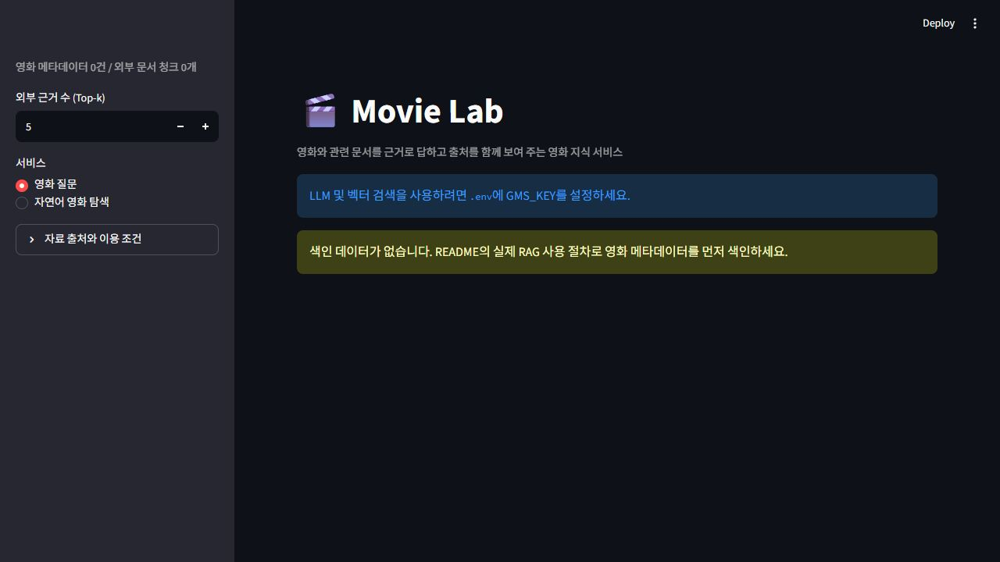
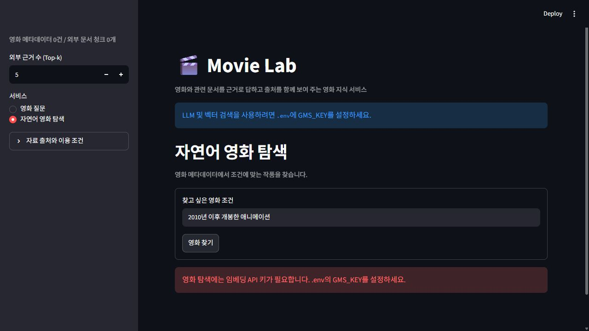
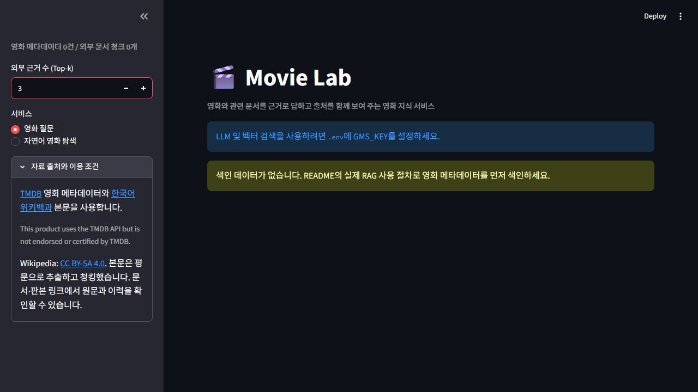

# 실제 브라우저 화면 증빙

2026-10-23에 학교 PC의 영화 앱 `http://127.0.0.1:8521/` 전용 탭을 확인했습니다. 기존 안내 화면 2장을 유지하고 출처 안내·Top-k 설정 화면 2장을 추가했습니다. 아래 4장은 실제 앱의 원본 캡처이며 합성·이미지 편집·모의 답변 주입을 하지 않았습니다.

앱에는 키와 색인이 없습니다. 유료 LLM·임베딩 호출은 0회입니다. 무료로 확인한 화면 조작과 모델이 필요한 질문 성공 검증을 구분합니다. 이전 무료 Wikipedia API 검증은 [별도 기록](evidence/wikipedia-api.json)에 있으며, 이 화면 캡처로 새 API 실행을 주장하지 않습니다.

| 화면 | 체크리스트 | 직접 확인한 내용 | 확인하지 않은 내용 |
|---|---|---|---|
| [색인 없음](evidence/13_empty_index.jpg) · 기존 | 13, 26 | 메타데이터·외부 청크 0, 키·색인 안내 | 실제 질문·수집·답변 |
| [키 없음](evidence/13_missing_key.jpg) · 기존 | 11, 13, 26 | 조건 입력 후 키 없음 안내 | 조건 탐색 결과 |
| [출처·이용 조건](evidence/24_sources_license.jpg) · 추가 | 19, 24, 26 | TMDB·위키백과 구분, 이용 조건 표시 | 생성 답변의 근거 번호·판본 대조 |
| [Top-k 설정 3](evidence/06_top_k3.jpg) · 추가 | 6, 26 | 표시값 5→3, 촬영 후 5 복구 | 실제 검색 결과·답변의 변화 |

## 색인 없음 안내

초기 영화 질문 화면입니다. 실제 색인 건수가 0이며 색인 절차를 안내합니다.

## 조건 탐색의 키 없음 안내

`2010년 이후 개봉한 애니메이션`을 제출한 기존 캡처입니다. 키 없음 메시지를 확인했으며 검색 성공 화면이 아닙니다.

## 출처와 이용 조건

자료 출처 패널을 펼쳐 TMDB·한국어 위키백과 링크, TMDB 이용 문구, CC BY-SA 4.0과 평문 추출·청킹 안내를 확인했습니다.

## Top-k 설정 변경

외부 근거 수를 5에서 3으로 변경한 실제 화면입니다. 촬영 후 원래 값 5로 복구했습니다. 실제 검색 결과 비교는 이전 [로컬 모의 검증](evidence/offline-flow.json)에만 기록되어 있으며, 이 캡처는 설정 조작만 증명합니다.

## 남은 확인

실제 GMS P1/P2·임베딩·답변, 수집 진행 화면, 영화별 실제 대화 전환, 사실 검증, 근거 번호·판본 대조와 실제 서비스 첫/두 번째 질문 시간은 미확인입니다. 학생 상호 평가도 미실시입니다. 27개 체크리스트의 기존 판정(통과 10, 미확인 12, 해당없음 5)은 바꾸지 않았습니다.

네 장 모두 API 키 값·개인정보·개인 대화가 보이지 않는지 시각적으로 확인했습니다. 화면의 `GMS_KEY`는 설정 이름입니다. [캡처 목록·SHA-256](evidence/screenshots.json), [테스트 결과표](test-results.md), [요구사항 대조표](requirements-matrix.csv), [셀프 체크리스트](checklist-self.xlsx)에서 확인 범위를 함께 볼 수 있습니다.
